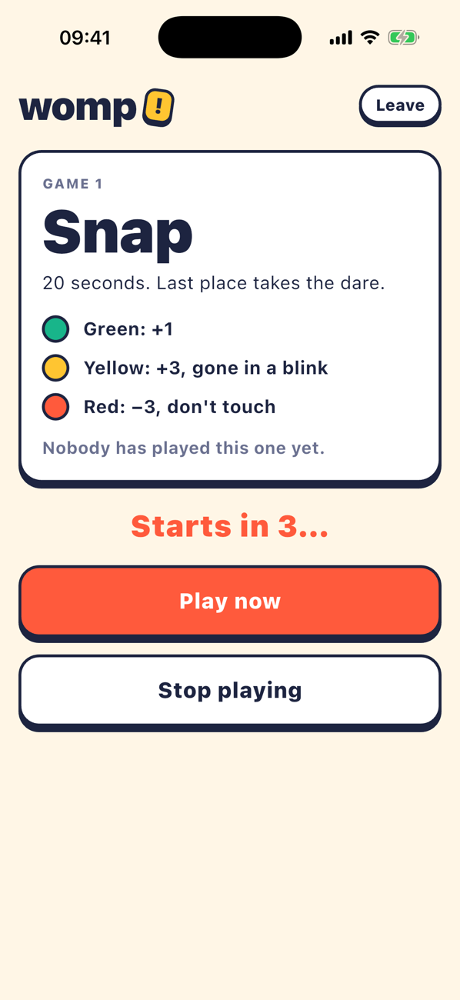
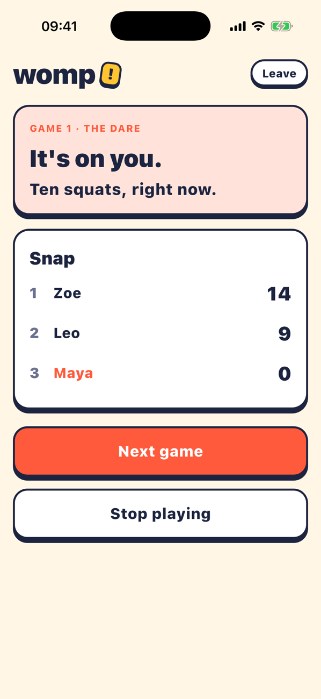
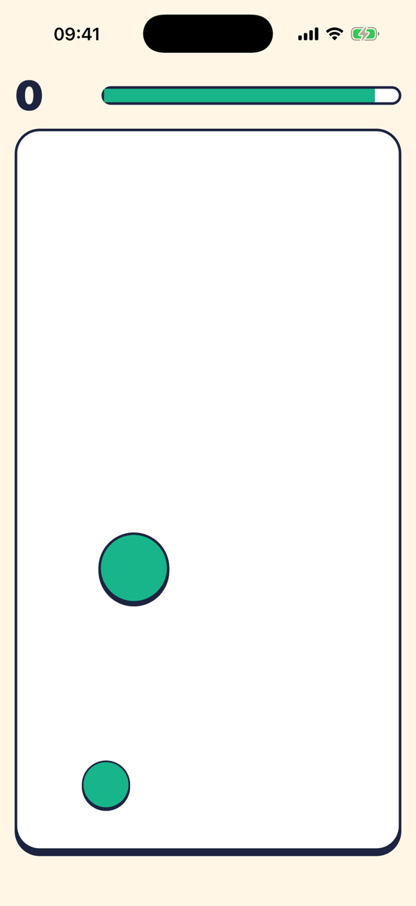
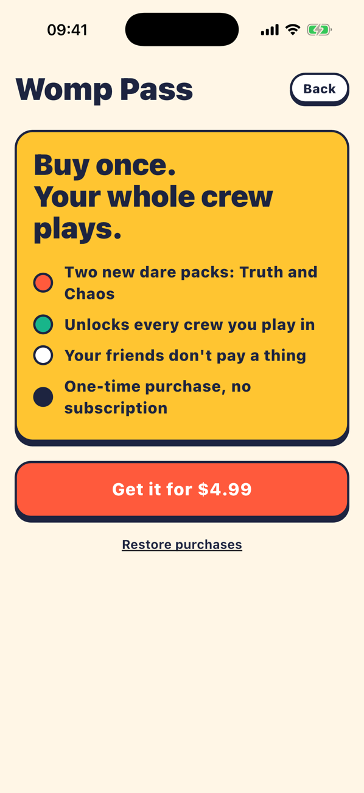

<p align="center">
  
</p>

<h1 align="center">Womp</h1>

<p align="center">
  <b>Quick games with your crew. Last place takes the dare.</b><br>
  A party game where everyone plays on their own phone, in sync.
</p>

<p align="center">
  
  &nbsp;
  
  &nbsp;
  
</p>

## How it works

Womp is played at a party, with the whole crew in the same room.

1. **One phone starts the crew.** It gets a 6-character code.
2. **Everyone else joins** with that code. Up to 12 players.
3. **Someone hits "Let's go".** The same game shows up on every phone, with its rules, and starts on its own a few seconds later.
4. **Everyone plays for 20 seconds** on their own phone. Everyone gets the exact same round.
5. **The dare lands right away** on last place, as soon as two players are done.
6. **"Next game"**, and on it goes.

The app speaks English, French and Spanish. It follows the phone's language, and the EN / FR / ES button at the top of the screen lets you pick another one.

## The games

Four games, rotating from one round to the next: Snap, Spot, Stop, Stash.

<table>
  <tr>
    <th width="25%">Snap</th>
    <th width="25%">Spot</th>
    <th width="25%">Stop</th>
    <th width="25%">Stash</th>
  </tr>
  <tr>
    <td align="center"></td>
    <td align="center"></td>
    <td align="center"></td>
    <td align="center"></td>
  </tr>
  <tr>
    <td>Dots pop up and shrink. Tap the good ones before they vanish.</td>
    <td>Every arrow points the same way, except one. Tap the odd one out.</td>
    <td>A bar slides back and forth along a track. Tap to stop it inside the zone.</td>
    <td>Tiles light up for a moment, then go dark. Find them from memory.</td>
  </tr>
  <tr>
    <td>
      Green: <b>+1</b><br>
      Yellow: <b>+3</b>, gone in a blink<br>
      Red: <b>−3</b>
    </td>
    <td>
      Right tile: <b>+1</b><br>
      Wrong tile: <b>−1</b>, and a short lock
    </td>
    <td>
      Red centre: <b>+3</b><br>
      Yellow zone: <b>+1</b><br>
      Outside: <b>−1</b>
    </td>
    <td>
      Tile found: <b>+1</b><br>
      Wrong tile: <b>−1</b>, and on to the next grid
    </td>
  </tr>
  <tr>
    <td>Dots come faster and faster, and stay for less and less time.</td>
    <td>The grid grows from 2×2 to 5×5. The odd arrow starts upside down, then is only a quarter turn off.</td>
    <td>Each bar moves faster than the last, with a narrower zone.</td>
    <td>From 3 tiles on a 3×3 grid to 7 tiles on a 5×5 grid, shown for less and less time.</td>
  </tr>
  <tr>
    <td>Tests your <b>reflexes</b></td>
    <td>Tests your <b>eye</b></td>
    <td>Tests your <b>timing</b></td>
    <td>Tests your <b>memory</b></td>
  </tr>
</table>

## Dares

Dares come from lists written in advance: never free text.

- **Classic dares**, by default: ten squats, talk like a robot until the next game, do your best impression of the winner…
- **Party dares**, optional. Only the crew's creator can turn them on, after confirming everyone is of legal drinking age. Each dare stays between one and three sips, water always counts, and every fifth game is a water round for everyone.
- **Truth and Chaos dares**, with the [Womp Pass](#womp-pass). Truth: last place answers a question honestly. Chaos: silly stunts that stay in the room. No alcohol in either.

The age check is self-declared: with anonymous accounts, nothing proves it.

## The flow

<table>
  <tr>
    <td align="center" width="25%"></td>
    <td align="center" width="25%"></td>
    <td align="center" width="25%"></td>
    <td align="center" width="25%"></td>
  </tr>
  <tr>
    <td><b>1. Welcome.</b> A first name, then start a crew or join one with its code. No account to create.</td>
    <td><b>2. The room.</b> Members showing up live, the code to share, the dare type, and the button to start.</td>
    <td><b>3. The game.</b> The game and its rules, then an automatic start on every phone.</td>
    <td><b>4. The dare.</b> The round's ranking and the dare for last place. Then the next game.</td>
  </tr>
</table>

"Leave" lets a player quit the crew and join another one.

## Womp Pass



A one-time purchase, sold with RevenueCat. Whoever has it unlocks every crew they play in: their friends pay nothing. For now it opens two dare packs, Truth and Chaos.

**It stays hidden until you switch it on.** Two locks:

1. a RevenueCat key in the build. Without one, the Pass can't show up;
2. the `pass` switch on the server, in the Firestore document `config/app`.

While the switch is off, the app reads that document once at launch and that's all: RevenueCat is never contacted, and the room looks exactly as it does without the Pass. A beta can ship with the code inside and nobody sees it.

### Setting it up, once

1. In App Store Connect and the Play Console, create a non-consumable product (one-time purchase), for example `womp_pass`.
2. In RevenueCat: a project with the iOS and Android apps, the `pass` entitlement attached to that product, and the current offering holding it as a *Lifetime* package.
3. Paste the public SDK keys (`appl_…`, `goog_…`) into `lib/config.dart`, or pass them at build time with `--dart-define=RC_APPLE_KEY=…` and `--dart-define=RC_GOOGLE_KEY=…`. These keys aren't secret.
4. Deploy the Firestore rules (see [Firebase](#firebase)).

### Switching it on

In the Firebase console: Firestore, collection `config`, document `app`, boolean field `pass` set to `true`. Each phone picks it up at its next launch. Set it back to `false` to hide the Pass again.

On the App Store, the version that carries the first in-app purchase goes through review with it: switch the Pass on before submitting that version, so the reviewer can find it. Apple doesn't allow a feature turned on after review.

### How it works

- The RevenueCat account uses the Firebase uid: a player keeps their Pass from one crew to the next.
- Once the purchase goes through, the phone writes its uid to the crew (`passBy`). Every phone in the crew sees the packs unlocked; only the creator picks the dares, as before.
- "Restore purchases" finds a Pass bought with the same Apple or Google account, for example after reinstalling.
- On the emulator, a fake store stands in for RevenueCat: purchases go through right away and charge nothing.

## Languages

By default the app follows the phone's language: English, French or Spanish. Any other language falls back to English.

The EN / FR / ES button, at the top of the welcome screen and the room, opens the language screen: phone language, English, Français or Español. The choice is kept on the phone between launches.

- All texts live in `lib/l10n/`: `en.dart`, `fr.dart`, `es.dart`. A language missing a text does not compile.
- Dare lists are aligned: dare #3 is the same in all three languages, so two friends using different languages read the same dare.
- Game names (Snap, Spot, Stop, Stash) and the app name stay the same everywhere.
- A crew's name is set when it is created, in its creator's language.

To add a language: copy `en.dart`, translate it, then add it to `S.supportedLocales`, `S.forLanguage` and `CFBundleLocalizations` in `ios/Runner/Info.plist`.

## Getting started

You need Flutter (the project is tested with 3.41) and Xcode or Android Studio.

```bash
flutter pub get
```

```bash
flutter run
```

The app then talks to the real Firebase project, `womp-crew`.

### Working without touching real data

The Firebase emulator runs locally. Its data is wiped when it stops.

```bash
firebase emulators:start --project demo-womp --only auth,firestore
```

```bash
flutter run --dart-define=EMULATOR=true
```

### Test helpers

| Option | Effect |
|---|---|
| `--dart-define=EMULATOR=true` | Local emulator instead of the real project |
| `--dart-define=GAME=spot` | Forces a game: `snap`, `spot`, `stop` or `stash`. Ignored outside the emulator, so a real party is never skewed |
| `--dart-define=LOCALE=fr` | Forces a language: `en`, `fr` or `es` |
| `--dart-define=SHORT=true` | 6-second games, auto start after a second and a half |
| `--dart-define=NAME=Maya` | Prefilled first name |
| `--dart-define=JOIN=ABC234` | Prefilled crew code |
| `--dart-define=RC_APPLE_KEY=appl_…` | RevenueCat key for iOS, instead of the one in `lib/config.dart` |
| `--dart-define=RC_GOOGLE_KEY=goog_…` | RevenueCat key for Android |

Add a fake player to the emulator's latest crew and have them play the current game:

```bash
python3 tool/live_player.py Leo 3 "Maya's crew"
```

Switch the Womp Pass on or off on the emulator, then relaunch the app:

```bash
python3 tool/pass_switch.py on
```

## Checks

```bash
flutter analyze
```

```bash
flutter test
```

Firestore security rules are checked against the emulator. The script plays fake players and checks what is allowed and what is denied.

```bash
python3 tool/rules_check.py
```

## Code layout

```
lib/
  core/        Game logic in plain Dart: each round is drawn from a seed
  games/       The four mini-games, with their shared clock and frame
  screens/     Welcome, crew room, game launcher, language picker, Womp Pass
  data/        Server access (Firestore, or in-memory for tests) and the Pass store (RevenueCat, or a fake one)
  l10n/        Texts, one file per language
  ui/          Style building blocks: card, button, pill
test/          Tests for the logic, the games, the flow, the languages and the Pass
tool/          Rules check, fake player, Pass switch, icon drawing
firestore.rules
```

Three design choices:

- **A round only depends on the crew and the round number.** Every phone computes it and gets the same one: only the round number and the scores go through the server.
- **Screens don't know about Firestore.** They go through `Repo`, so the whole flow can be tested in memory.
- **One style.** Ink outline, hard shadow with no blur, flat colours, five of them. Every screen reuses the building blocks in `lib/ui/kit.dart`.

## Firebase

| | |
|---|---|
| Project | `womp-crew` |
| Sign-in | Anonymous, no form |
| Database | Firestore, region `nam5` |
| App ID | `app.womp.womp` on iOS and Android |

What the rules guarantee:

- you can only read a crew and its games if you are a member;
- you can only join a crew if you know its code, and never past 12 members;
- you can only leave a crew by removing yourself;
- only a crew's creator picks the dare type, out of four known values; Truth and Chaos need a crew unlocked by the Pass;
- a member unlocks the crew with the Pass once, in their own name only;
- the app settings (`config`) can be read, never written from the app;
- the round number only moves forward, and only the current round accepts scores;
- one score per player per round, between −150 and 150, that can't be replaced or posted for someone else.

Deploy the rules:

```bash
firebase deploy --only firestore:rules --project womp-crew --account encheres.nc@gmail.com
```

Always run `python3 tool/rules_check.py` against the emulator before deploying changed rules.

## Adding a game

1. Write its logic in plain Dart in `lib/core/games.dart`: a function that draws the round from a seed.
2. Write its screen in `lib/games/`, using `RoundClock` and `RoundFrame`.
3. Add it to `GameId`, `rotation`, `PlayScreen`, the rule colours in `lib/screens/room.dart`, and `rules` in the three language files.
4. Test that the round is identical for a given seed and that the score stays within bounds.

Two pitfalls:

- A score outside −150 to 150 is silently rejected by the server. `clampScore` takes care of it, and a test checks it.
- Adding a game to `rotation` changes the sequence: two versions of the app would no longer play the same game in the same round.

## Icon

The icon is drawn by a script, in the app's colours.

```bash
python3 tool/make_icon.py && dart run flutter_launcher_icons
```

## Project status

This is an MVP that plays end to end, not yet a release.

**Done**
- A crew started by one phone, joined by code, left at will
- Four mini-games in a row, in sync on every phone
- Instant dare, classic or party
- English, French and Spanish, with a language picker
- Womp Pass with RevenueCat, hidden behind a server switch
- iOS and Android

**Before a closed beta**
- Tune game difficulty and length by hand, on real phones
- Launch screen and signed builds
- Usage and crash tracking

**Before a public release**
- Set up RevenueCat and the store products, then switch the Pass on
- More in the Pass before charging for it, new games first
- Server-side score validation, against cheating
- App Check and a separate database for testing
- Privacy policy and terms of use
- Decide what to do with party dares: app age rating, Apple and Google rules on alcohol
- Tappable invite link

**Known limits**
- Scores are computed on the phone: the rules bound them, but can't check the game was actually played.
- The Pass purchase isn't checked by the server: a modified app could unlock a crew without paying. The fix is a RevenueCat webhook to a Cloud Function, which needs the paid Firebase plan.
- Accounts are anonymous: one is lost if the app is uninstalled. "Restore purchases" brings the Pass back.
- Players' age isn't verified: the check asked for party dares is a simple statement.
- If the creator leaves the crew, nobody can change the dare type anymore.
- A member who isn't at the party shows up in "Still playing" every round, until they leave the crew.
