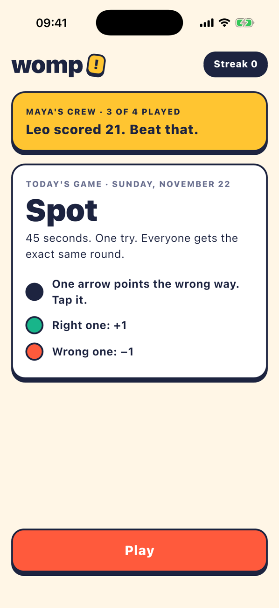
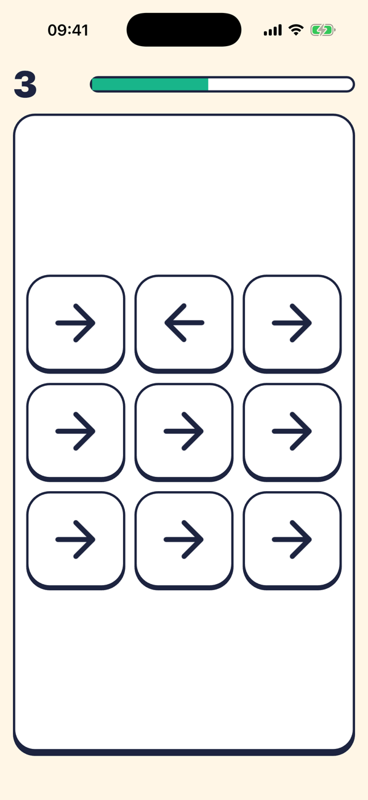
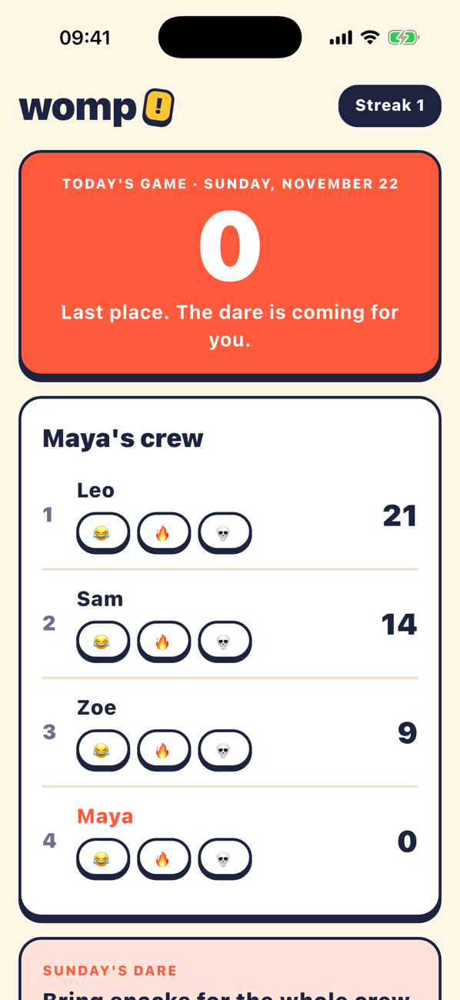
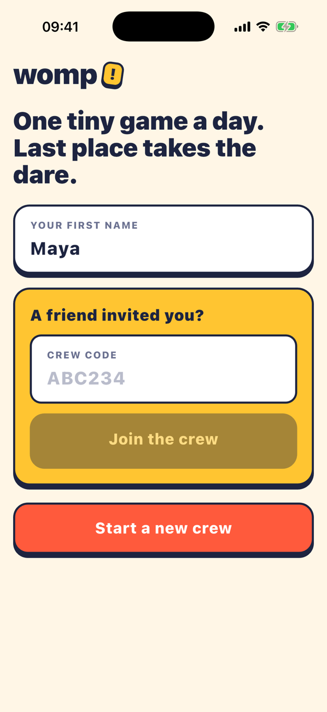

<p align="center">
  
</p>

<h1 align="center">Womp</h1>

<p align="center">
  <b>One tiny game a day. Last place takes the dare.</b><br>
  Un mini-jeu par jour avec ta bande. Le dernier prend le gage.
</p>

<p align="center">
  
  &nbsp;
  
  &nbsp;
  
</p>

## Le principe

Womp est un réseau social où l'on ne poste rien : on joue.

- **Une bande.** Jusqu'à 12 amis, qu'on rejoint avec un code à 6 caractères.
- **Un jeu par jour.** 45 secondes, une seule tentative, la même partie pour tout le monde.
- **Le score est le post.** Le classement de la bande se remplit en direct, avec des réactions.
- **Un gage par semaine.** Il tombe sur le dernier du classement.

L'app est en anglais, pensée pour un premier lancement anglophone.

## Les jeux

Le jeu change chaque jour, dans l'ordre Snap, Spot, Stop. Il est tiré de la date : toute la bande joue au même.

<table>
  <tr>
    <th width="34%">Snap</th>
    <th width="33%">Spot</th>
    <th width="33%">Stop</th>
  </tr>
  <tr>
    <td align="center"></td>
    <td align="center"></td>
    <td align="center"></td>
  </tr>
  <tr>
    <td>Des pastilles apparaissent et rétrécissent. On touche les bonnes avant qu'elles disparaissent.</td>
    <td>Toutes les flèches pointent du même côté, sauf une. On touche l'intruse.</td>
    <td>Une barre va et vient sur une piste. On touche l'écran pour l'arrêter dans la zone.</td>
  </tr>
  <tr>
    <td>
      Verte : <b>+1</b><br>
      Jaune : <b>+3</b>, elle file vite<br>
      Rouge : <b>−3</b>
    </td>
    <td>
      Bonne tuile : <b>+1</b><br>
      Mauvaise tuile : <b>−1</b>, et un court blocage
    </td>
    <td>
      Centre rouge : <b>+3</b><br>
      Zone jaune : <b>+1</b><br>
      En dehors : <b>−1</b>
    </td>
  </tr>
  <tr>
    <td>Les pastilles arrivent de plus en plus vite et durent de moins en moins longtemps.</td>
    <td>La grille passe de 2×2 à 5×5. L'intruse, d'abord à l'envers, n'est ensuite tournée que d'un quart.</td>
    <td>30 barres. Chacune va plus vite que la précédente, avec une zone plus étroite.</td>
  </tr>
  <tr>
    <td>Ce que ça teste : <b>le réflexe</b></td>
    <td>Ce que ça teste : <b>l'œil</b></td>
    <td>Ce que ça teste : <b>le rythme</b></td>
  </tr>
</table>

## Le parcours

<table>
  <tr>
    <td align="center" width="33%"></td>
    <td align="center" width="34%"></td>
    <td align="center" width="33%"></td>
  </tr>
  <tr>
    <td><b>1. Arriver.</b> Un prénom, puis on crée sa bande ou on en rejoint une par son code. Aucun compte à créer.</td>
    <td><b>2. Jouer.</b> Le jeu du jour, ses règles, et le score à battre dans la bande.</td>
    <td><b>3. Comparer.</b> Le classement en direct, les réactions, et le gage qui attend le dernier.</td>
  </tr>
</table>

## Démarrer

Il faut Flutter (le projet est testé avec la version 3.41), et Xcode ou Android Studio.

```bash
flutter pub get
```

```bash
flutter run
```

L'app parle alors au vrai projet Firebase, `womp-crew`.

### Travailler sans toucher aux vraies données

L'émulateur Firebase tourne en local. Ses données disparaissent quand on l'arrête.

```bash
firebase emulators:start --project demo-womp --only auth,firestore
```

```bash
flutter run --dart-define=EMULATOR=true
```

### Aides de test

| Option | Effet |
|---|---|
| `--dart-define=EMULATOR=true` | Émulateur local au lieu du vrai projet |
| `--dart-define=GAME=spot` | Force un jeu : `snap`, `spot` ou `stop`. Ignoré hors émulateur, pour ne pas fausser une vraie bande |
| `--dart-define=SHORT=true` | Manche de 6 secondes |
| `--dart-define=NAME=Maya` | Prénom prérempli |
| `--dart-define=JOIN=ABC234` | Code de bande prérempli |

Faire entrer un faux joueur dans une bande de l'émulateur :

```bash
python3 tool/second_player.py Leo 21 "Maya's crew"
```

## Vérifier

```bash
flutter analyze
```

```bash
flutter test
```

Les règles de sécurité Firestore se contrôlent contre l'émulateur. Le script joue de faux joueurs et vérifie ce qui est permis et refusé.

```bash
python3 tool/rules_check.py
```

## Organisation du code

```
lib/
  core/        Logique des jeux en Dart pur : la partie du jour, tirée de la date
  games/       Les trois mini-jeux, leur horloge et leur cadre communs
  screens/     Arrivée, jeu du jour, classement de la bande
  data/        Accès au serveur : Firestore pour l'app, mémoire pour les tests
  ui/          Les briques du style : carte, bouton, pastille
test/          Tests de la logique, des jeux et du parcours
tool/          Contrôle des règles, faux joueur, dessin de l'icône
firestore.rules
```

Trois partis pris :

- **La partie ne dépend que de la date.** Aucun serveur ne distribue le jeu du jour : chaque téléphone le recalcule et obtient le même.
- **Les écrans ne connaissent pas Firestore.** Ils passent par `Repo`, ce qui permet de tester tout le parcours en mémoire.
- **Un seul style.** Trait d'encre, ombre dure sans flou, aplats, cinq couleurs. Tout écran réutilise les briques de `lib/ui/kit.dart`.

## Firebase

| | |
|---|---|
| Projet | `womp-crew` |
| Connexion | Anonyme, sans formulaire |
| Base | Firestore, région `nam5` |
| Identifiant d'app | `app.womp.womp` sur iOS et Android |

Ce que les règles garantissent :

- on ne lit une bande, ses scores et ses réactions que si l'on en est membre ;
- on n'entre dans une bande qu'en connaissant son code, et jamais à plus de 12 ;
- un seul score par joueur et par jour, qu'on ne peut ni remplacer ni poster au nom d'un autre ;
- un score reste entre −150 et 150, et le jour doit coller à l'heure du serveur.

Publier les règles et la configuration de connexion :

```bash
firebase deploy --only firestore,auth --project womp-crew
```

## Ajouter un jeu

1. Écrire sa logique en Dart pur dans `lib/core/games.dart` : une fonction qui tire la partie de la date.
2. Écrire son écran dans `lib/games/`, avec `RoundClock` et `RoundFrame`.
3. L'ajouter à `GameId`, à `rotation`, à `PlayScreen` et aux règles affichées dans `lib/screens/home.dart`.
4. Tester que la partie est identique pour un même jour et que le score reste dans les bornes.

Deux pièges :

- Un score hors de −150 à 150 est refusé par le serveur sans message. `clampScore` s'en charge, un test le vérifie.
- Ajouter un jeu à `rotation` décale tous les jours suivants. Deux versions de l'app ne joueraient plus au même jeu le même jour.

## Icône

L'icône est dessinée par un script, dans les couleurs de l'app.

```bash
python3 tool/make_icon.py && dart run flutter_launcher_icons
```

## État du projet

C'est un MVP jouable de bout en bout, pas encore une version publiable.

**Fait**
- Trois mini-jeux en rotation quotidienne
- Bandes, invitation par code, classement et réactions en direct
- Règles de sécurité publiées et testées
- iOS et Android

**À faire avant une bêta fermée**
- Régler la difficulté des jeux au doigt, sur un vrai téléphone
- Notifications : un ami a joué, il reste peu de temps
- Le gage du dimanche : classement de la semaine et annonce du perdant
- Suivi d'usage et des plantages
- Écran de lancement et builds signés

**À faire avant une sortie publique**
- Validation des scores côté serveur, contre la triche
- Comptes durables et suppression de compte
- Signalement, blocage, quitter une bande
- App Check et base séparée pour les essais
- Politique de confidentialité et conditions d'utilisation
- Lien d'invitation cliquable

**Limites connues**
- Le score est calculé sur le téléphone : les règles le bornent, sans pouvoir vérifier qu'il a été joué.
- Le compte est anonyme : il est perdu si l'app est désinstallée.
- Le jour est fixé au lancement de l'app, il ne change pas si elle reste ouverte après minuit.
- La série de jours est tenue sur le téléphone, pas sur le serveur.
