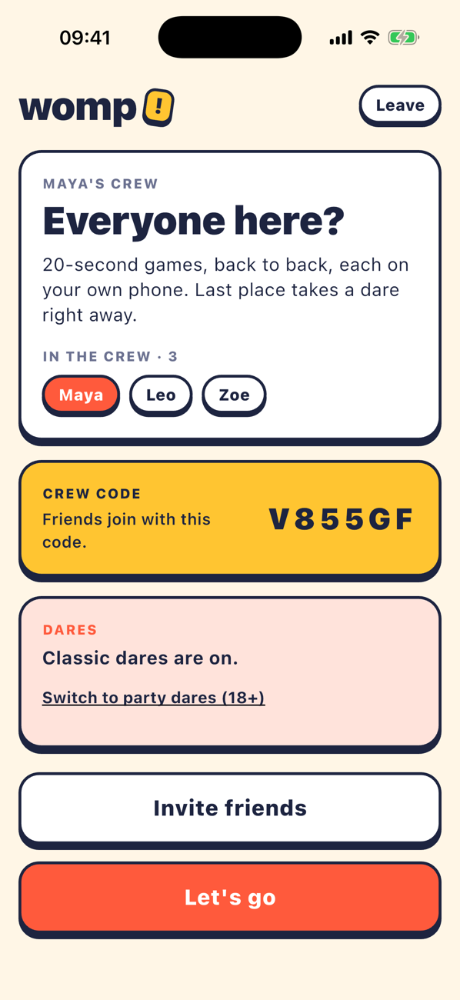
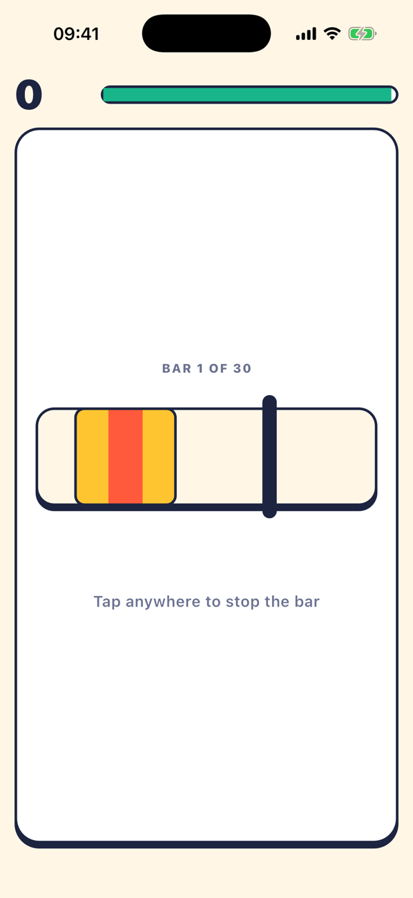
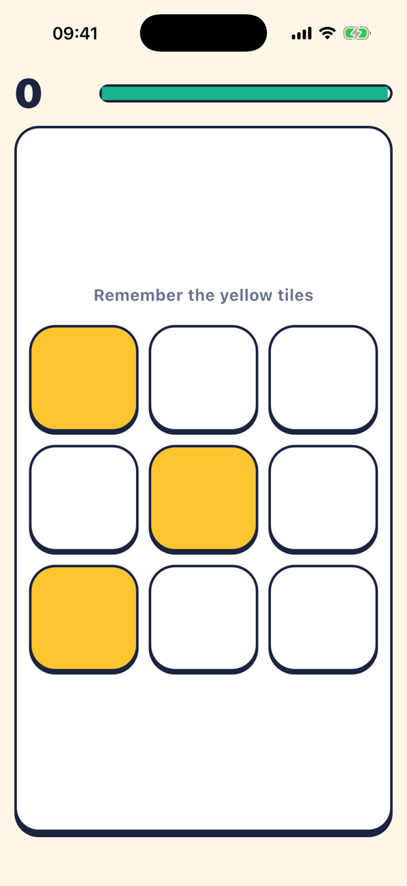

<p align="center">
  
</p>

<h1 align="center">Womp</h1>

<p align="center">
  <b>Quick games with your crew. Last place takes the dare.</b><br>
  Des mini-jeux entre potes, chacun sur son téléphone. Le dernier prend le gage.
</p>

<p align="center">
  
  &nbsp;
  
  &nbsp;
  
</p>

## Le principe

Womp se joue en soirée, quand la bande est réunie.

1. **Un téléphone crée la bande.** Il obtient un code à 6 caractères.
2. **Les autres la rejoignent** avec ce code. Jusqu'à 12 joueurs.
3. **Quelqu'un lance les jeux.** Le même jeu s'affiche sur tous les téléphones, avec ses règles, et démarre tout seul au bout de quelques secondes.
4. **Chacun joue 20 secondes** sur son téléphone. Tout le monde a exactement la même partie.
5. **Le gage tombe tout de suite** sur le dernier, dès que deux joueurs ont fini.
6. **« Next game »**, et on enchaîne.

L'app parle anglais, français et espagnol : elle suit la langue du téléphone, et le bouton EN / FR / ES en haut de l'écran permet d'en choisir une autre.

## Les jeux

Quatre jeux, qui tournent de manche en manche dans l'ordre Snap, Spot, Stop, Stash.

<table>
  <tr>
    <th width="25%">Snap</th>
    <th width="25%">Spot</th>
    <th width="25%">Stop</th>
    <th width="25%">Stash</th>
  </tr>
  <tr>
    <td align="center"></td>
    <td align="center"></td>
    <td align="center"></td>
    <td align="center"></td>
  </tr>
  <tr>
    <td>Des pastilles apparaissent et rétrécissent. On touche les bonnes avant qu'elles disparaissent.</td>
    <td>Toutes les flèches pointent du même côté, sauf une. On touche l'intruse.</td>
    <td>Une barre va et vient sur une piste. On touche l'écran pour l'arrêter dans la zone.</td>
    <td>Des cases s'allument un instant, puis s'éteignent. On les retrouve de mémoire.</td>
  </tr>
  <tr>
    <td>
      Verte : <b>+1</b><br>
      Jaune : <b>+3</b>, elle file vite<br>
      Rouge : <b>−3</b>
    </td>
    <td>
      Bonne tuile : <b>+1</b><br>
      Mauvaise tuile : <b>−1</b>, et un court blocage
    </td>
    <td>
      Centre rouge : <b>+3</b><br>
      Zone jaune : <b>+1</b><br>
      En dehors : <b>−1</b>
    </td>
    <td>
      Case retrouvée : <b>+1</b><br>
      Mauvaise case : <b>−1</b>, et on passe à la grille suivante
    </td>
  </tr>
  <tr>
    <td>Les pastilles arrivent de plus en plus vite et durent de moins en moins longtemps.</td>
    <td>La grille passe de 2×2 à 5×5. L'intruse, d'abord à l'envers, n'est ensuite tournée que d'un quart.</td>
    <td>Chaque barre va plus vite que la précédente, avec une zone plus étroite.</td>
    <td>De 3 cases sur 3×3 à 7 cases sur 5×5, affichées de moins en moins longtemps.</td>
  </tr>
  <tr>
    <td>Ce que ça teste : <b>le réflexe</b></td>
    <td>Ce que ça teste : <b>l'œil</b></td>
    <td>Ce que ça teste : <b>le rythme</b></td>
    <td>Ce que ça teste : <b>la mémoire</b></td>
  </tr>
</table>

## Les gages

Les gages viennent de listes écrites d'avance : jamais de texte libre.

- **Gages classiques**, par défaut : dix squats, parler comme un robot jusqu'au prochain jeu, imiter le gagnant…
- **Gages à boire**, en option. Seul le créateur de la bande peut les activer, après avoir confirmé que tout le monde a l'âge légal. Chaque gage reste entre une et trois gorgées, l'eau compte, et un jeu sur cinq est une pause eau pour tout le monde.

La confirmation d'âge est déclarative : avec des comptes anonymes, rien ne la prouve.

## Le parcours

<table>
  <tr>
    <td align="center" width="25%"></td>
    <td align="center" width="25%"></td>
    <td align="center" width="25%"></td>
    <td align="center" width="25%"></td>
  </tr>
  <tr>
    <td><b>1. Arriver.</b> Un prénom, puis on crée la bande ou on la rejoint avec son code. Aucun compte à créer.</td>
    <td><b>2. Le salon.</b> Les membres en direct, le code à partager, le choix des gages, et le bouton pour lancer.</td>
    <td><b>3. La manche.</b> Le jeu et ses règles, puis le départ automatique sur tous les téléphones.</td>
    <td><b>4. Le gage.</b> Le classement de la manche et le gage du dernier. Puis le jeu suivant.</td>
  </tr>
</table>

« Leave » permet de quitter la bande pour en rejoindre une autre.

## Langues

Par défaut, l'app suit la langue du téléphone : anglais, français ou espagnol. Toute autre langue retombe sur l'anglais.

Le bouton EN / FR / ES, en haut de l'accueil et du salon, ouvre l'écran de langue : « Langue du téléphone », English, Français ou Español. Le choix est gardé sur le téléphone d'un lancement à l'autre.

- Tous les textes sont dans `lib/l10n/` : `en.dart`, `fr.dart`, `es.dart`. Une langue à laquelle il manque un texte ne compile pas.
- Les listes de gages sont alignées : le gage n°3 est le même dans les trois langues. Deux amis qui n'ont pas la même langue lisent donc le même gage.
- Les noms des jeux (Snap, Spot, Stop, Stash) et de l'app ne changent pas.
- Le nom d'une bande est fixé à sa création, dans la langue de son créateur.

Ajouter une langue : copier `en.dart`, traduire, puis l'ajouter à `S.supportedLocales`, à `S.forLanguage` et à `CFBundleLocalizations` dans `ios/Runner/Info.plist`.

## Démarrer

Il faut Flutter (le projet est testé avec la version 3.41), et Xcode ou Android Studio.

```bash
flutter pub get
```

```bash
flutter run
```

L'app parle alors au vrai projet Firebase, `womp-crew`.

### Travailler sans toucher aux vraies données

L'émulateur Firebase tourne en local. Ses données disparaissent quand on l'arrête.

```bash
firebase emulators:start --project demo-womp --only auth,firestore
```

```bash
flutter run --dart-define=EMULATOR=true
```

### Aides de test

| Option | Effet |
|---|---|
| `--dart-define=EMULATOR=true` | Émulateur local au lieu du vrai projet |
| `--dart-define=GAME=spot` | Force un jeu : `snap`, `spot`, `stop` ou `stash`. Ignoré hors émulateur, pour ne pas fausser une vraie partie |
| `--dart-define=LOCALE=fr` | Force une langue : `en`, `fr` ou `es` |
| `--dart-define=SHORT=true` | Manches de 6 secondes, départ au bout d'une seconde et demie |
| `--dart-define=NAME=Maya` | Prénom prérempli |
| `--dart-define=JOIN=ABC234` | Code de bande prérempli |

Faire entrer un faux joueur dans la bande la plus récente de l'émulateur et lui faire jouer la manche en cours :

```bash
python3 tool/live_player.py Leo 3 "Maya's crew"
```

## Vérifier

```bash
flutter analyze
```

```bash
flutter test
```

Les règles de sécurité Firestore se contrôlent contre l'émulateur. Le script joue de faux joueurs et vérifie ce qui est permis et refusé.

```bash
python3 tool/rules_check.py
```

## Organisation du code

```
lib/
  core/        Logique des jeux en Dart pur : chaque partie est tirée d'une graine
  games/       Les quatre mini-jeux, leur horloge et leur cadre communs
  screens/     Arrivée, salon de la bande, lancement d'un jeu, choix de la langue
  data/        Accès au serveur : Firestore pour l'app, mémoire pour les tests
  l10n/        Les textes, un fichier par langue
  ui/          Les briques du style : carte, bouton, pastille
test/          Tests de la logique, des jeux, du parcours et des langues
tool/          Contrôle des règles, faux joueur, dessin de l'icône
firestore.rules
```

Trois partis pris :

- **La partie ne dépend que de la bande et du numéro de manche.** Chaque téléphone la recalcule et obtient la même : seuls le numéro de manche et les scores passent par le serveur.
- **Les écrans ne connaissent pas Firestore.** Ils passent par `Repo`, ce qui permet de tester tout le parcours en mémoire.
- **Un seul style.** Trait d'encre, ombre dure sans flou, aplats, cinq couleurs. Tout écran réutilise les briques de `lib/ui/kit.dart`.

## Firebase

| | |
|---|---|
| Projet | `womp-crew` |
| Connexion | Anonyme, sans formulaire |
| Base | Firestore, région `nam5` |
| Identifiant d'app | `app.womp.womp` sur iOS et Android |

Ce que les règles garantissent :

- on ne lit une bande et ses parties que si l'on en est membre ;
- on n'entre dans une bande qu'en connaissant son code, et jamais à plus de 12 ;
- on ne quitte une bande qu'en se retirant soi-même ;
- seul le créateur d'une bande choisit le type de gages, parmi deux valeurs connues ;
- le numéro de manche ne fait qu'avancer, et seule la manche en cours accepte des scores ;
- un seul score par joueur et par manche, entre −150 et 150, qu'on ne peut ni remplacer ni poster au nom d'un autre.

Publier les règles :

```bash
firebase deploy --only firestore:rules --project womp-crew --account encheres.nc@gmail.com
```

Toujours lancer `python3 tool/rules_check.py` contre l'émulateur avant de publier des règles modifiées.

## Ajouter un jeu

1. Écrire sa logique en Dart pur dans `lib/core/games.dart` : une fonction qui tire la partie d'une graine.
2. Écrire son écran dans `lib/games/`, avec `RoundClock` et `RoundFrame`.
3. L'ajouter à `GameId`, à `rotation`, à `PlayScreen`, aux couleurs des règles dans `lib/screens/room.dart`, et à `rules` dans les trois fichiers de langue.
4. Tester que la partie est identique pour une même graine et que le score reste dans les bornes.

Deux pièges :

- Un score hors de −150 à 150 est refusé par le serveur sans message. `clampScore` s'en charge, un test le vérifie.
- Ajouter un jeu à `rotation` change l'enchaînement : deux versions de l'app ne joueraient plus au même jeu à la même manche.

## Icône

L'icône est dessinée par un script, dans les couleurs de l'app.

```bash
python3 tool/make_icon.py && dart run flutter_launcher_icons
```

## État du projet

C'est un MVP jouable de bout en bout, pas encore une version publiable.

**Fait**
- Bande créée par un téléphone, rejointe par code, quittée librement
- Quatre mini-jeux enchaînés, synchronisés sur tous les téléphones
- Gage immédiat, classique ou à boire
- Anglais, français et espagnol, avec un écran pour choisir la langue
- iOS et Android

**À faire avant une bêta fermée**
- Régler la difficulté et la durée des jeux au doigt, sur de vrais téléphones
- Écran de lancement et builds signés
- Suivi d'usage et des plantages

**À faire avant une sortie publique**
- Validation des scores côté serveur, contre la triche
- App Check et base séparée pour les essais
- Politique de confidentialité et conditions d'utilisation
- Décider du sort des gages à boire : classement d'âge de l'app, règles d'Apple et de Google sur l'alcool
- Lien d'invitation cliquable

**Limites connues**
- Le score est calculé sur le téléphone : les règles le bornent, sans pouvoir vérifier qu'il a été joué.
- Le compte est anonyme : il est perdu si l'app est désinstallée.
- L'âge des joueurs n'est pas vérifié : la confirmation demandée pour les gages à boire est une simple déclaration.
- Si le créateur quitte la bande, plus personne ne peut changer le type de gages.
- Un membre qui n'est pas à la soirée apparaît dans « Still playing » à chaque manche, tant qu'il n'a pas quitté la bande.
